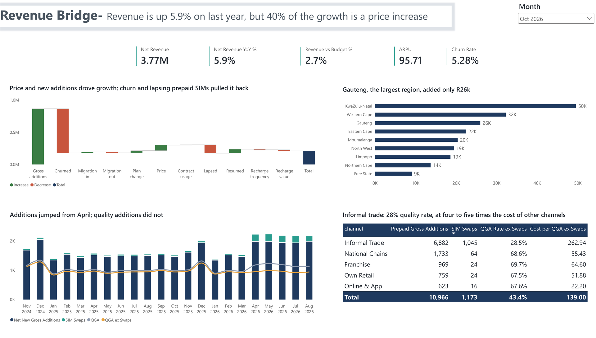
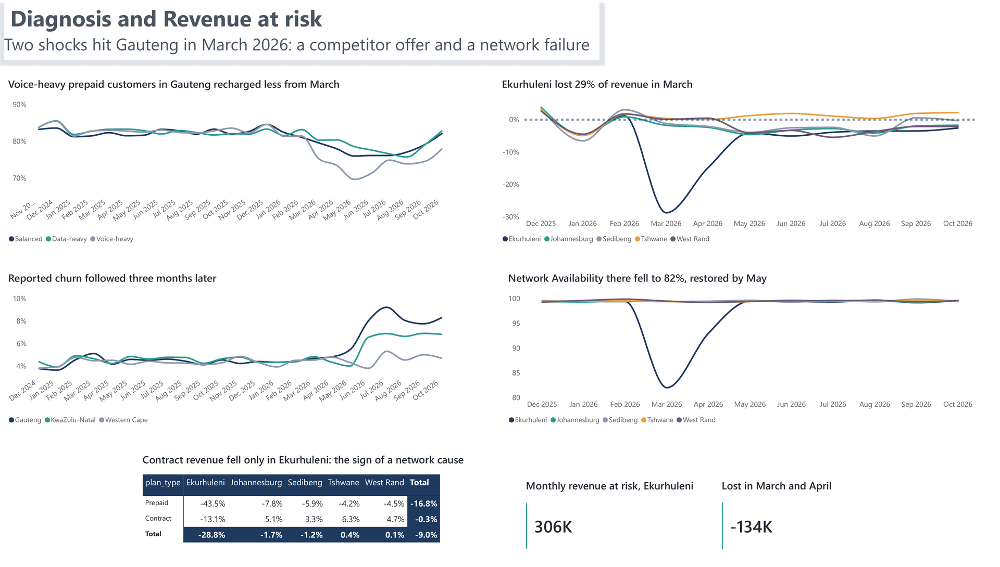
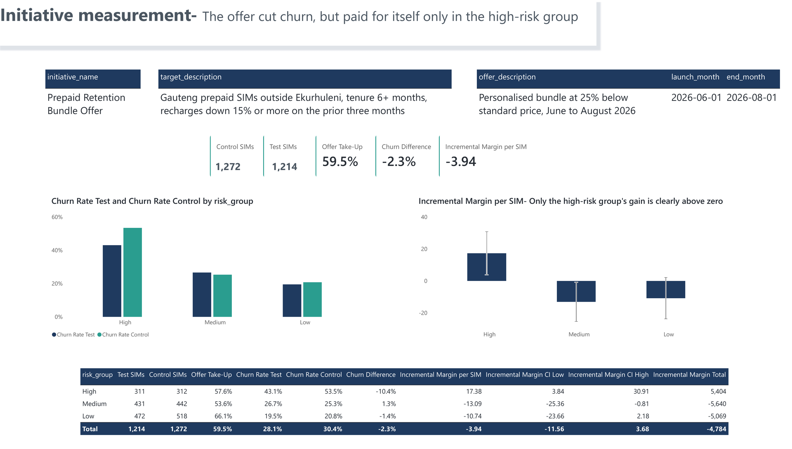
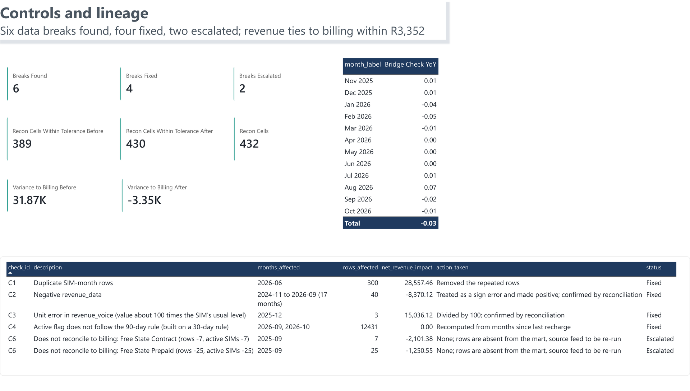
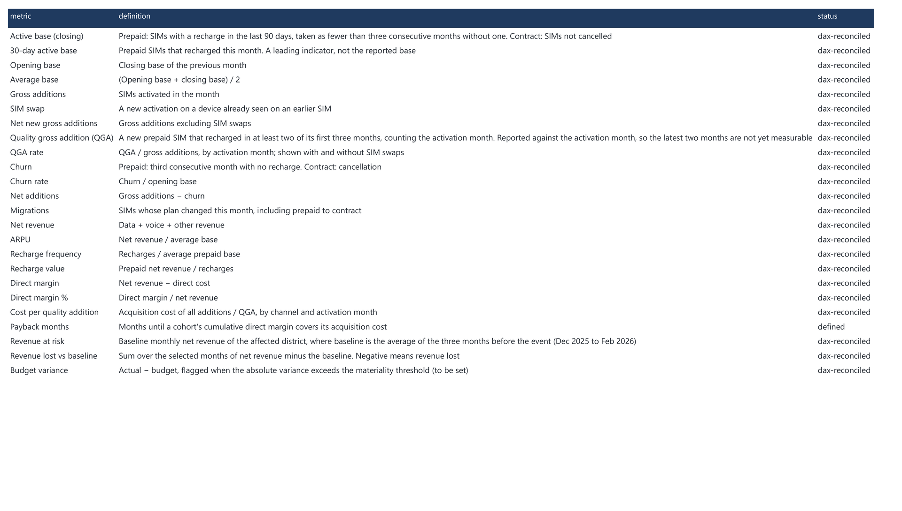
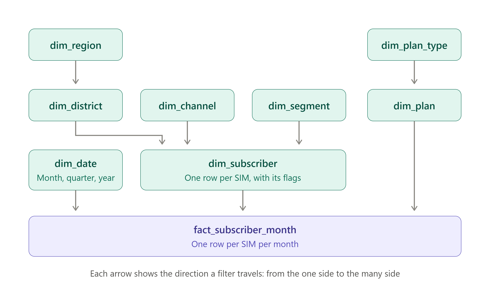

# Telco Commercial Performance & Initiative Impact

A Power BI commercial performance pack for a fictional South African mobile operator, built
on a synthetic data pipeline where every reported number is verified twice.

> **The data is synthetic and the operator is fictional.** No real company's data, prices or
> customers are used. The data generator plants known commercial events, and the analysis is
> judged on whether it recovers them. Findings below are statements about that planted
> scenario, not about any real business.

**[View the full report as a PDF](docs/CommercialPerformance.pdf)** (five pages, no software needed)

## The question

The October 2026 month-end pack looks healthy: revenue is up on last year and ahead of
budget, and gross additions are at a record. **Is the prepaid recovery real?**

## The short answer

Not as real as the headline suggests.

- **Revenue is up 5.9% on last year (R211,391), but 40% of that is a contract price
  increase** (R85,670). Prepaid ARPU is lower than a year ago.
- **Record gross additions are low quality.** A commission push through informal trade
  lifted prepaid additions by about 40%, but the share that kept recharging fell from 56% to
  43%, and to 28% once SIM swaps are excluded. A quality addition through that channel cost
  about R263, four to five times the other channels.
- **Two different shocks hit Gauteng in March 2026, and the data separates them.** A
  competitor offer drew voice-heavy prepaid customers across the province. A network failure
  hit one district, Ekurhuleni, across all customer types. Contract revenue fell only in
  Ekurhuleni, which is the signature of the network cause.
- **Recharging fell three months before reported churn moved.** Under a 90-day inactivity
  rule, churn is a lagging measure. Sizing the revenue at risk early (about R306,000 a month
  in Ekurhuleni) is the case for acting before churn shows it.
- **The retention offer cut churn but paid for itself only in the high-risk group.** Margin
  per SIM rose R17.38 there (95% interval R3.84 to R30.91). Across all targeted SIMs the
  effect was −R3.94 (−R11.56 to +R3.68), which cannot be told apart from zero.

## The report

### 1. Revenue bridge

Why revenue moved against the same month last year, and whether new customers are staying.



Each SIM is assigned to exactly one situation between the two months (new, churned, changed
plan, stayed), so the bridge components sum exactly to the total movement with no
unexplained residual.

### 2. Diagnosis and revenue at risk

What caused the Gauteng decline, and how much revenue was exposed in the damaged district.



Ekurhuleni lost about 29% of revenue in March 2026 as network availability fell to 82%, and
about R134,000 across March and April before service was restored.

### 3. Initiative measurement

A retention offer measured against a randomised control group, by risk group, with the
uncertainty shown.



Margin is compared as each SIM's change from its own pre-launch baseline, test against
control. The evidence supports retargeting the offer to the high-risk group, not extending
it as it is.

### 4. Controls and lineage

Whether the numbers can be trusted, what broke, and what was done about it.



Validation found six data breaks. Four were fixed and confirmed by reconciliation; two could
not be fixed from the reporting data and were escalated. Reconciliation cells within
tolerance rose from 389 to 430 of 432, and the revenue variance to billing fell from R31,872
to −R3,352, which is exactly the escalated missing rows.

### 5. Metric definitions

Every metric's definition and verification status, loaded into the report from
[`docs/metric_dictionary.md`](docs/metric_dictionary.md).



## How the numbers were verified

1. **A known truth.** The generator plants each event with stated parameters and writes them
   to [`data/ground_truth.json`](data/ground_truth.json). The analysis has to find them.
2. **Reconciliation to source.** `validate.py` checks the reporting data against billing
   control totals by month, region and plan type, with stated tolerances. It recovered all
   five planted data-quality breaks, to the cent.
3. **Every measure computed twice.** Each KPI is calculated in Python
   (`reference_kpis.py`) and again in DAX. The two were compared at every grain; counts,
   revenue and margin match exactly.
4. **The bridge proves itself.** Check measures in the model confirm, for every month, that
   the bridge components equal the revenue movement taken straight from the fact table.

## How it is built

```
generate_data.py  ->  validate.py  ->  build_model_tables.py  ->  Power BI model  ->  report
   data/raw            data/clean          data/model               (PBIP, TMDL)
                            |
                     reference_kpis.py  ->  data/reference  (the figures DAX must match)
```

- **Python** (pandas, numpy) for data generation, validation and reference calculations.
- **Power BI** saved as a project (PBIP), so the semantic model is plain text under
  [`powerbi/`](powerbi/) and every change is reviewable in git.
- **Semantic model:** 20 tables, 23 single-direction relationships, 70 measures, all with
  descriptions. See [`docs/model_spec.md`](docs/model_spec.md).



Row-level logic (the bridge, quality-addition flags, per-SIM offer outcomes) is computed once
in Python and loaded as tables, so DAX measures stay simple sums and ratios.

## Reproduce it

Requires Python 3.10 or later and Power BI Desktop.

```
python -m venv .venv
.venv\Scripts\activate
pip install -r requirements.txt
python src/generate_data.py
python src/validate.py
python src/reference_kpis.py
python src/build_model_tables.py
```

The generator is seeded, so the output is identical on every run. Then open
`powerbi/CommercialPerformance.pbip`, set the `DataFolder` parameter to the full path of your
`data\model` folder, and refresh.

## Repository

| Path | Contents |
|------|----------|
| `src/` | Data generator, validation, reference calculations, model table build |
| `powerbi/` | Power BI project: semantic model and report |
| `data/ground_truth.json` | What was planted in the data |
| `docs/business_case.md` | The scenario, event timeline and definitions |
| `docs/metric_dictionary.md` | Metric definitions and verification status |
| `docs/model_spec.md` | Tables, relationships, measures and verification anchors |
| `docs/report_build.md` | Every visual, its fields and the figure it was checked against |
| `docs/decisions.md` | Dated log of design decisions and known limitations |

## Assumptions and limitations

- All metric definitions are this project's own assumptions, for example churn as three
  consecutive months without a recharge, and a quality addition as a new SIM that recharged
  in at least two of its first three months.
- The bridge compares each month with the previous month and with the same month a year
  earlier. Other comparisons would need the bridge table extended.
- Revenue lost in the damaged district is measured against a fixed three-month baseline, so
  it includes seasonal change as well as the event.
- The retention offer's overall margin effect is small compared with the variation between
  SIMs. Only the high-risk and medium-risk results are clearly different from zero.
- Results come from one seeded run of the generator.

## How this was made

The Python code and the DAX measures were written with AI coding assistance (Claude Code,
with Microsoft's Power BI Modeling MCP server applying the model). My own work was the
business case and storyline, the choice of events and definitions, the verification
standard, running and checking the pipeline, and building every report page by hand in
Power BI Desktop.
